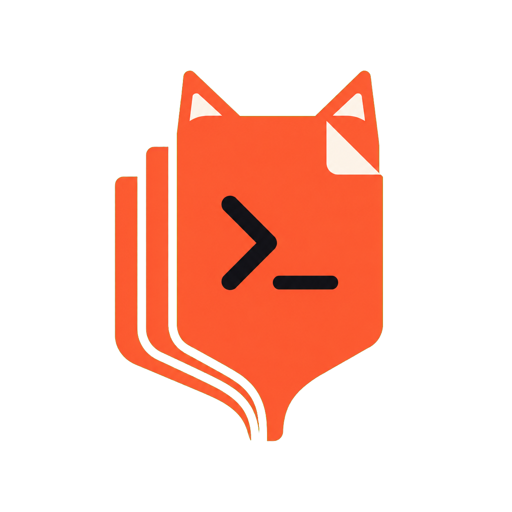

# promptcat

<p align="center">
    
</p>

[](https://github.com/Vortex93/promptcat/actions/workflows/ci.yml)

`promptcat` turns a set of source or text files into one prompt-friendly document.

It is designed for the common workflow of collecting a focused slice of a repository and pasting it into ChatGPT, Claude, Copilot Chat, or another LLM without manually opening and copying files one by one.

```text
<<<FILE: "cmd/promptcat/promptcat.go">>>
package main
...
<<<END FILE>>>
```

## Why promptcat

- Concatenate multiple files into one stable text stream
- Expand glob patterns inside the tool for predictable cross-shell behavior
- Filter inputs with `--include`, `--exclude`, `--ignore-dir`, and positional `!pattern` exclusions
- Skip binary files automatically by extension and content detection
- Output relative paths by default or absolute paths with `--fullpath`
- Create deterministic TAR + Zstandard archives with `promptcat archive`
- Export original files plus indexed navigation in a ZIP with `promptcat archive --chatgpt`
- Copy normal Promptcat output to the system clipboard with `promptcat clipboard`

## Installation

`promptcat` currently installs from source with Go.

Requirements:
- Go `1.27` or newer

### Windows

PowerShell:

```powershell
go install github.com/Vortex93/promptcat/cmd/promptcat@latest
promptcat --version
```

If `promptcat` is not found, add `$(go env GOPATH)\bin` to your `PATH`.
The default location is usually `%USERPROFILE%\go\bin`.

Current terminal session:

```powershell
$env:Path += ";$(go env GOPATH)\bin"
```

### macOS

```bash
go install github.com/Vortex93/promptcat/cmd/promptcat@latest
promptcat --version
```

If `promptcat` is not found, add `$(go env GOPATH)/bin` to your `PATH`.
The default location is usually `~/go/bin`.

Current terminal session:

```bash
export PATH="$(go env GOPATH)/bin:$PATH"
```

### Linux

```bash
go install github.com/Vortex93/promptcat/cmd/promptcat@latest
promptcat --version
```

If `promptcat` is not found, add `$(go env GOPATH)/bin` to your `PATH`.
The default location is usually `~/go/bin`.

Current terminal session:

```bash
export PATH="$(go env GOPATH)/bin:$PATH"
```

### Build From a Clone

```bash
git clone https://github.com/Vortex93/promptcat.git
cd promptcat
go test ./...
```

On macOS and Linux, install this checkout using Bash and Go:

```bash
./install.sh
```

The script runs `go install ./cmd/promptcat`, matching `mise run install`. It
honors `GOBIN` (or defaults to `$(go env GOPATH)/bin`) and works from any working
directory. Add the installation directory to your `PATH` if needed.

Build the binary locally into `bin/`:

macOS and Linux:

```bash
go build -o bin/promptcat ./cmd/promptcat
```

Windows:

```powershell
go build -o bin/promptcat.exe ./cmd/promptcat
```

## Quick Start

Collect all Go files under `cmd/`:

```bash
promptcat "cmd/**/*.go"
```

Collect only Go and Markdown files while ignoring noisy directories:

```bash
promptcat --include=go,md --ignore-dir=.git,node_modules "**/*"
```

Include absolute paths in the output:

```bash
promptcat --fullpath README.md "cmd/**/*.go"
```

Write the result to a file you can paste elsewhere:

```bash
promptcat --include=go,md README.md "cmd/**/*.go" > prompt.txt
```

Skip files larger than 1 MB:

```bash
promptcat --max-size=1MB "**/*.json"
```

Auto-detect project files:

```bash
promptcat auto > prompt.txt
```

Archive source files in the current folder:

```bash
promptcat archive
```

All archive formats select readable UTF-8 text regardless of filename or extension. They skip common dependency, generated, cache, temporary, and VCS directories, including `.git`, `node_modules`, `vendor`, `dist`, `build`, `target`, and `coverage`; they also skip symlinks, Git-ignored files, sensitive filenames and private-key content, media (including SVG), archives, binary content, and files over 1 MiB by default. Inside Git repositories, Git's normal rules apply: tracked files are not ignored, nested repositories use their own rules, and Git must be installed. Outside repositories, nested `.gitignore` files are matched without Git, including directory rules and negation; matching starts at the selected archive folder.

These checks are best-effort, not secret detection or redaction: review source files **and Git patches** before sharing. Some text is not UTF-8 and will be skipped. Use `--explain` to see the first reason each path was skipped; ignored directories are reported once without listing their contents.

By default, files are formatted as `export.txt` inside `archive.tar.zst`; use `--files` to store them separately. The archive uses Zstandard level 3 and is replaced when rerunning the command. `--pattern` restricts the selection; `--include` adds patterns to that restriction (without `--pattern`, all names are already candidates). Neither option bypasses safety filters. Use `--max-size` to change the per-file limit:

```bash
promptcat archive --include=**.json,**.yaml
promptcat archive --pattern=**.js,**.ts --output=source.tar.zst
promptcat archive --max-size=10MB
promptcat pack . --explain
promptcat archive --ai --output=source.tar.zst
promptcat archive --exclude-repo=apps/legacy --exclude-repo=vendor/tool
```

Use `--exclude-repo=PATH` to omit a repository folder and everything beneath it from the archive. Paths are relative to the archive folder; repeat the option to exclude more than one folder. This also removes those files from `--ai` repository metadata and patches.

`--ai` adds a lightweight `.promptcat/` navigator and project metadata. The metadata lists each Git repository found under the selected folder (including linked worktrees) with its archive-relative path, branch/commit, changes to included files, and patch paths. Under `.promptcat/patches/`, root-repository patches go in `root/` and nested repositories go under `repo/<repo-path>/`. Each contains one `<commit-hash>.patch` per commit ahead of `origin/HEAD` (falling back to the configured upstream when the remote default branch is unavailable), plus `worktree.patch` for staged and unstaged tracked-file edits. Patch contents are restricted to files included in the archive; untracked files are included as source files but not repeated in the patch. Multiple repositories stay together in one archive. The included Python tool builds symbol and relationship indexes when used, so creating the archive does not need to analyze every source file up front. It works with both formatted (`export.txt`) and `--files` archive layouts.

### ChatGPT source-review preset

For a ChatGPT conversation with Python/file-extraction tools, use:

```bash
promptcat pack .
# Optional: choose the ZIP name.
promptcat pack . --output=project.zip
# Or put <project-name>.zip in an existing directory.
promptcat pack . --output=~/Downloads/
# Equivalent existing command:
promptcat archive --chatgpt --output=project.zip
# Optional: also copy the ZIP as a file object to your clipboard.
promptcat archive --chatgpt --clipboard
```

`pack [folder]` is a shortcut for `archive --chatgpt`. The folder defaults to the
current directory. It supports the same archive options, including `--include`,
`--pattern`, `--max-size`, `--ignore-dir`, `--exclude-repo`, and `--clipboard`.

After scanning and filtering, pack shows one progress bar while processing source
files, then reports the file count, skipped paths, archive size, duration, and
destination on stderr. The bar appears only when both stdout and stderr are
interactive terminals; redirected output contains only the plain summary unless
details are requested. `NO_COLOR` disables colors. `--verbose` lists included and
skipped paths; `--explain` lists skip reasons only. Pruned directories count as
one skipped path, not all their files.

`--chatgpt` implies `--ai` and `--files`, defaults to `archive.zip`, and requires a
`.zip` output path or an existing output directory. A directory uses the selected
folder's name for the ZIP; relative outputs are resolved inside that folder. A
successful export replaces an existing output file; a failed ZIP export leaves it
unchanged. It uses Go's standard-library ZIP writer, so creating or
extracting this format does not need `tar` or `zstd`. TAR/Zstandard workflows
use the same file selection rules but keep their output formats.

The default archive selection includes Caddyfiles and environment templates such as
`public.env.example` and `vpn.env.sample`, but not live `.env` or `public.env`
files. Review all selected files for secrets before sharing an archive.

The ZIP contains the selected source files at their original relative paths,
without concatenation, added line numbers, or rewritten line endings. It also has:

- `START_HERE.md`: a selective-reading workflow and snapshot limitations.
- `.promptcat/files.json`: paths, language/role hints, line counts, sizes, SHA-256
  hashes of archived bytes, selection rules, and reasons for skipped candidates.
- The existing `.promptcat/project.json`, Python navigator, and scoped Git patches.

After attaching the ZIP, a useful request is:

> Extract the archive and read `START_HERE.md`. Investigate [your task].
> Read relevant source, imports, and tests; do not dump the whole repository.
> Return a unified patch against the included source files.

With an indexed ZIP, the navigator lists paths without loading source contents;
`read` loads only the requested file, and prefix-filtered `search` reads only
matching paths. Plain-text search releases each file after scanning it to limit
memory usage; semantic relationship searches may still scan many files. The
inventory takes precedence even when a real source file is named `export.txt`.

```bash
python .promptcat/tools.py files --limit 50 --offset 0
python .promptcat/tools.py files auth --json
python .promptcat/tools.py search "createUser" src/ --limit 20
python .promptcat/tools.py read src/auth.ts 1 120
```

`files` and `map` support `--offset` pagination. A default `read` shows at most 80
lines and 16,000 output characters. Explicit line ranges, `--source-lines N`, and
`--max-chars N` can expand those bounds; long search lines are marked previews.
Continuation/truncation notices go to stderr, leaving JSON stdout parseable.

ChatGPT ZIP exports follow symbolic links by default, including targets outside
the selected folder, while keeping the link's original relative path. Linked
files are stored as regular files. Directory cycles and broken links are skipped
with warnings; directory exclusions and size limits still apply. Review linked
targets before sharing an archive, since they may contain private files.

The preset keeps existing patterns, directory exclusions, `--exclude-repo`, and the
1 MiB default per-file limit. It records oversized, binary, and non-UTF-8 matching
files as skipped rather than silently decoding or altering them. Ignored folders
and unmatched paths are described by selection rules, not individually enumerated.
Unreadable selected sources fail the export. Each validated source is written
directly to the temporary ZIP without a staged disk copy; only generated
metadata is staged. A failed ZIP write leaves an existing destination intact.
Source reading is per-file, not an atomic repository snapshot. Git metadata and
patches cover only included source paths. Git repos without commits still export
source files, but cannot provide commit history or HEAD-based patches.

A ZIP upload does **not** guarantee automatic indexing, full-context loading, or
better model accuracy. Available file tools vary by ChatGPT setup. Without archive
extraction tools, use a focused text export or upload the relevant files directly.
Review source **and Git patches** before sharing: this is not a secret-redaction
tool, and patches can contain historical data. Do not apply included historical
patches over the already-current source snapshot.

Create the archive and copy the generated `.tar.zst` file to the system clipboard as a file:

```bash
promptcat archive --clipboard
```

Copy Promptcat output directly to the system clipboard. Folder inputs are scanned
recursively using the same source-file defaults, directory exclusions, and 1 MiB
size limit as `archive`. With no inputs, the folder is the current directory:

```bash
promptcat clipboard
promptcat clipboard .
promptcat clipboard src
promptcat clipboard README.md "cmd/**/*.go"
```

Files, globs, and folders can be combined. `--include` and `--exclude` filter
extensions; `--ignore-dir` adds directory exclusions and `--max-size` changes the
size limit. Clipboard exports keep the existing policy of skipping symbolic links.

On Linux, Promptcat uses `wl-copy`, `xclip`, or `xsel`; macOS uses `pbcopy`, and Windows uses `clip`.

Generate or install shell completion for Bash, Fish, Zsh, or PowerShell:

```bash
promptcat autocomplete bash
promptcat autocomplete install fish
promptcat autocomplete install
```

The install form detects the current shell when no shell is specified. Bash, Fish, and Zsh completion files are installed in their standard user completion directories; PowerShell completion is added to the user profile without removing existing profile content.

Update an installed copy from the latest GitHub release. Promptcat downloads the matching platform build and verifies its checksum before replacing the current executable:

```bash
promptcat update
```

The legacy `--upgrade` option remains available.

## Usage

```text
promptcat [options] <files...>
```

Inputs can be a mix of direct file paths and glob patterns.
Directories passed directly are skipped.

### Options

| Option | Description |
| --- | --- |
| `-h`, `--help` | Show help output |
| `-v`, `--version` | Show version and build metadata |
| `update` | Download and install the latest GitHub release for this platform |
| `--upgrade` | Legacy alias for `update` |
| `--max-size=1MB` | Skip files larger than the specified size |
| `--fullpath` | Output absolute paths instead of the provided relative paths |
| `--include=go,md` | Include only these extensions |
| `archive` | Archive matching source files as `archive.tar.zst` with Zstandard level 3 |
| `--include=**.json,**.yaml` | Add archive glob patterns to the defaults |
| `--pattern=**.js,**.ts` | Replace archive glob patterns entirely |
| `--output=source.tar.zst` | Set the archive output path |
| `--max-size=1MB` | Set the maximum archive file size; defaults to 1 MiB for archives |
| `--files` | Store matching files separately instead of generating `export.txt` |
| `--ai` | Add the lightweight AI navigation tool and project metadata |
| `--chatgpt` | ZIP preset: original files, AI navigator, file inventory, and reading guide |
| `--exclude-repo=PATH` | Exclude a repository folder and its contents (repeatable; relative to the archive folder) |
| `--clipboard` | Also copy the generated archive file to the clipboard; `--files` requires `--chatgpt` when copying |
| `autocomplete [shell]` | Print completion for Bash, Fish, Zsh, or PowerShell |
| `autocomplete install [shell]` | Install completion, detecting the current shell when omitted |
| `--exclude=json,lock` | Exclude these extensions |
| `--ignore-dir=.git,node_modules` | Skip files whose path contains any of these directory names |
| `!pattern` | Exclude files matching this glob pattern |
| `auto` | Detect project stacks and select relevant files from current directory |

Notes:
- Extensions can be written with or without a leading dot
- `--include`, `--exclude`, and `--ignore-dir` accept comma-separated values
- `--exclude-repo` accepts one folder path per option; paths are relative to the archive folder
- `--max-size` accepts bytes or suffixes such as `KB`, `MB`, `GB`, `KiB`, and `MiB`
- Binary files are skipped automatically
- Symbolic links are skipped automatically
- Directory traversal is unsorted internally, then results are sorted once for deterministic output
- Files stream serially to preserve deterministic output and immediate error handling
- `auto` cannot be combined with explicit file paths or glob patterns
- `update` downloads the matching release archive, verifies its checksum, and replaces the current executable
- `!pattern` exclusions apply after all positive paths and glob patterns expand

### Auto Mode

`promptcat auto` detects mixed projects and selects source files, relevant manifests/configuration, root documentation, and GitHub Actions workflows. It supports Go; JavaScript, TypeScript, React, Vue, Svelte, Angular, Astro, and Nuxt; Python; Rust; Java and Kotlin; C#; Ruby; PHP; Swift; Dart/Flutter; Elixir; shell; Docker/Compose; and Terraform/HCL.

Auto mode skips lockfiles and common generated or dependency folders including `.git`, `node_modules`, `vendor`, `.venv`, `venv`, `__pycache__`, `.pytest_cache`, `.mypy_cache`, `.ruff_cache`, `.tox`, `.nox`, `.pixi`, `dist`, `build`, `coverage`, `target`, `.next`, `.nuxt`, `.svelte-kit`, and `.cache`. Use `--include`, `--exclude`, `--ignore-dir`, or `--max-size` to narrow its selection further.

## Globs and Shells

Quote glob patterns so `promptcat` expands them itself instead of letting your shell do it first.
That keeps behavior more consistent across Bash, Zsh, Fish, PowerShell, and `cmd.exe`.
Supported syntax includes `*`, `**`, `?`, and character classes such as `[ab]`, `[a-z]`, and `[!a]`.
Absolute glob paths are supported.

Recommended forms:

- macOS and Linux shells: `promptcat "cmd/**/*.go"`
- PowerShell: `promptcat 'cmd/**/*.go'`
- Windows Command Prompt: `promptcat "cmd/**/*.go"`

Prefer forward slashes in patterns even on Windows.
Examples such as `cmd/**/*.go` work across platforms.

Use a quoted `!pattern` to remove matching files. `--exclude` filters file extensions; `!pattern` filters paths:

```bash
promptcat "**/*.md" "!**/excluded/*.md"
promptcat "**/*" "!**/generated/**" "!**/vendor/**"
```

Supported pattern features:

- `*` matches within a single path segment
- `?` matches a single character within a path segment
- `**` matches across directories

## Output Format

Each file is wrapped in markers:

```text
<<<FILE: "path/to/file">>>
<file contents>
<<<END FILE>>>
```

This makes the output easy to paste into prompts and easy for downstream tooling to split or parse again later.

## Development

The repository includes a small `mise.toml` for local workflows.
Multi-step workflows run through ZX scripts in `scripts/`.

```bash
mise run setup
mise run build
mise run test
mise run install
mise run release VERSION=0.1.8
```

Direct Go commands work as well:

```bash
go build ./cmd/promptcat
go test ./...
go install ./cmd/promptcat
```

`mise run build` uses `default.pgo` automatically when that profile is present; otherwise it builds without PGO. It creates native and opposite-platform binaries; release builds use Go's `-pgo=auto` mode.

Regenerate the project profile from the representative small-file benchmark:

```bash
go test ./cmd/promptcat -cpuprofile=default.pgo -run '^$' -bench '^BenchmarkStreamFilesSmallFiles$' -benchtime=5s
```

Continuous integration runs the build and test workflow on Windows, macOS, and Linux.

To publish a new GitHub release, push a semantic version tag:

```bash
mise run release VERSION=0.1.8
```

That task runs tests, creates the `v0.1.8` tag, and pushes it to GitHub.
The GitHub Actions release workflow then builds the binaries and publishes the release assets from GitHub-hosted runners.

## Contributing

Guidelines live in [`CONTRIBUTING.md`](./CONTRIBUTING.md).

## License

This project is licensed under the [MIT License](./LICENSE).
